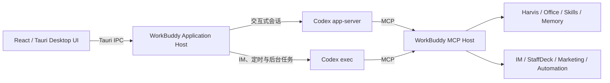

<div align="center">


# 小亨 WorkBuddy

**让 AI 不只回答问题，还能在项目、文档、创作、工具与 IM 会话中完成工作。**

[](https://github.com/yu536686/xiaoheng-workbuddy/releases/tag/v1.0.0-beta.4)
[](#windows-安装)
[](https://tauri.app/)
[](https://react.dev/)
[](https://www.rust-lang.org/)
[](https://github.com/openai/codex)

[下载 Windows 版](https://github.com/yu536686/xiaoheng-workbuddy/releases/latest) · [功能概览](#功能概览) · [安装与配置](#windows-安装) · [源码构建](#从源码构建) · [问题排查](#常见问题)

</div>

---

## 项目简介

小亨 WorkBuddy 是一款面向 Windows 的桌面 AI Agent 工作台。它将对话、项目、任务、文件、长期记忆、技能、创作工具、办公文档和即时通讯整合到同一套工作流中，让模型能够理解目标、调用工具、请求批准、持续执行并交付可下载的成果。

主会话由 **Codex app-server** 驱动，无人值守任务通过 **Codex exec** 执行；Harvis、Office、技能、记忆、IM、StaffDeck 等业务能力由独立的 **WorkBuddy MCP Host** 提供。界面继续负责项目与会话管理、Todo、活动记录、权限审批和成果展示。

> 当前版本为 Beta，建议先在受控环境中完成模型、权限和工作区配置，再用于正式业务数据。

## 功能概览

| 能力 | 说明 |
| --- | --- |
| **Agent 对话工作台** | 支持流式回复、附件、模型切换、Todo、工具活动、权限审批、成果卡片和任务中断。 |
| **项目与会话** | 按项目目录组织会话，保存上下文、工作区、文件引用和 Codex Thread 映射。 |
| **StaffDeck 多 Agent 协作** | 创建不同职责的人员，分派任务，在看板中跟踪执行状态和交付结果。 |
| **Harvis AI 创作** | 提供图片与音乐创作页面，支持参考图、提示词助手、任务进度、结果预览与下载。 |
| **Office 成果生成** | 通过 Artifact Runtime 创建并验证 Word、PowerPoint 和 Excel 文件，生成后直接进入成果区。 |
| **技能与 MCP** | 统一管理系统技能、市场技能和 MCP 服务，让 Agent 按任务加载对应能力。 |
| **长期记忆** | 保存用户偏好、项目事实和执行经验，并通过关键词与向量检索按需注入上下文。 |
| **素材库与数据看板** | 登录后浏览、筛选和预览素材，将文件暂存到会话，或基于看板数据新建分析任务。 |
| **IM 渠道** | 支持企业微信智能机器人长连接和个人微信 iLink，将消息转为可持续执行的 Agent 会话。 |
| **自动化与桌面工具** | 支持定时任务、文件操作、Shell、浏览器控制和 Windows UI 自动化。 |

## 运行架构



- **Codex app-server**：管理交互式线程、上下文、计划、工具调用、审批和增量事件。
- **Codex exec**：运行 IM、定时任务和其他无头任务。
- **WorkBuddy Application Host**：管理桌面窗口、用户、项目、会话索引、权限 UI 和成果索引。
- **WorkBuddy MCP Host**：向 Agent 提供业务工具，不维护第二套 Agent Loop。

## Windows 安装

### 系统要求

- Windows 10 或 Windows 11 x64，推荐使用最新 Windows 11。
- Microsoft Edge WebView2 Runtime。Windows 11 通常已经内置，安装程序也会按需引导安装。
- 可访问所选模型服务的网络，以及对应供应商的 API Key。
- 若使用 Office 桌面控制能力，需要安装 Microsoft Office。
- 若使用企业微信企业能力，需要安装并初始化 `@wecom/cli`。

### 1. 下载安装包

进入 [Releases](https://github.com/yu536686/xiaoheng-workbuddy/releases) 页面，下载最新的 Windows x64 安装包：

```text
Xiaoheng-WorkBuddy-<version>-x64-setup.exe
```

需要核对文件完整性时，在安装包所在目录运行：

```powershell
Get-FileHash .\Xiaoheng-WorkBuddy-<version>-x64-setup.exe -Algorithm SHA256
```

将输出与对应 Release 中公布的 SHA-256 摘要比较。

### 2. 运行安装程序

双击安装包并按提示完成安装。当前 Beta 安装包可能尚未包含受信任的 Windows 代码签名，因此 SmartScreen 或智能应用控制可能显示“未知发布者”。请只使用本仓库 Release 提供的安装包，并先核对 SHA-256；正式分发版本应使用受信任证书签名。

### 3. 初始化运行环境

首次启动时，小亨会检测以下运行环境：

1. Git
2. Node.js
3. Python
4. WeCom CLI

每个环境都有独立的“安装”按钮。安装完成后应用会自动重新检测；若状态没有更新，可点击“重新检测”或重启应用。

在网络受限环境中，可以将离线安装包放在应用安装目录旁的 `installers` 或 `offline-installers` 目录。支持的文件形式包括：

```text
Git-*.exe
node-*.msi / node-*.exe
python-*.exe
wecom-cli*.tgz
```

### 4. 登录或跳过

- **登录**：解锁线上营销工作台、素材库、数据看板、技能市场和团队协作等高阶模块。
- **注册**：打开线上注册页面。新账号需要管理员审批后才能登录高阶模块。
- **跳过**：直接进入基础对话功能，之后可以从左下角账户菜单再次登录。

### 5. 配置模型

首次配置页面提供供应商指引、API Key 输入、模型列表获取、默认模型和启用模型选择。

当前 Codex 主执行链路重点验证：

- OpenAI Responses API
- DeepSeek Responses API

设置界面还提供 Anthropic、通义千问、MiniMax、智谱 GLM、Kimi、SiliconFlow 和自定义 OpenAI 兼容接口。实际可用性取决于供应商是否兼容当前 Codex Responses 执行协议。

推荐配置流程：

1. 选择 AI 供应商。
2. 按页面链接创建并填写 API Key。
3. 点击“获取模型列表”。
4. 选择启动/默认模型。
5. 勾选允许在会话底部切换的模型。
6. 选择工作区目录和会话权限策略。

API Key 和 IM 密钥在写入本地设置前使用 ChaCha20-Poly1305 加密。模型请求会发送到用户选择的模型服务，请根据业务的数据安全要求配置供应商和权限模式。

## 常用配置

### 会话权限

小亨提供不同的执行权限级别。需要修改文件、运行 Shell 或控制桌面时，Agent 会遵循当前会话权限并在必要时弹出批准请求。建议日常使用“请求批准”，只在可信任务中开启“完全访问”。

### 企业微信

1. 在企业微信中创建智能机器人，选择 API 模式并启用长连接。
2. 在“设置 → IM 渠道 → 企业微信”填写 Bot ID 和 Secret。
3. 保存后点击“连接渠道”。
4. 如需通讯录、消息、文档、会议、日程和待办能力，再执行：

```powershell
npx --yes @wecom/cli auth init
```

旧版 CLI 使用：

```powershell
npx --yes @wecom/cli init
```

### 个人微信 iLink

1. 在“设置 → IM 渠道 → 微信”启用通道。
2. 保存设置并点击“连接渠道”。
3. 点击“绑定微信”，使用手机微信扫描二维码并确认授权。

绑定完成后，微信消息会关联到 WorkBuddy 的 IM 项目会话。

## 从源码构建

### 获取源码

仓库当前为私有项目，拉取前需要具有访问权限并完成 GitHub 登录：

```powershell
git clone https://github.com/yu536686/xiaoheng-workbuddy.git
cd xiaoheng-workbuddy
git switch main
```

### 一键准备并构建

在 Windows 11 管理员 PowerShell 中运行：

```powershell
Set-ExecutionPolicy -Scope Process Bypass
.\scripts\bootstrap-windows.ps1
```

脚本会检查并安装 Node.js、Rust MSVC 工具链和 Visual Studio C++ Build Tools，然后完成依赖安装、前端构建、格式检查、Clippy 检查和安装包构建。

### 已有开发环境

环境要求：

- Git
- Node.js 22 或更高版本
- Rust stable MSVC toolchain
- Visual Studio 2022 Build Tools，包含“使用 C++ 的桌面开发”工作负载

执行：

```powershell
npm ci
npm test
npm run build
cargo test --manifest-path src-tauri\Cargo.toml --workspace
npm run tauri build -- --target x86_64-pc-windows-msvc --bundles nsis,msi
```

构建产物位于：

```text
target\x86_64-pc-windows-msvc\release\bundle\nsis\
target\x86_64-pc-windows-msvc\release\bundle\msi\
```

## GitHub Actions 构建

仓库包含 [`Build Windows Installer`](.github/workflows/build-windows.yml) 工作流：

- 在 GitHub 的 **Actions** 页面手动运行，可生成 Windows 构建产物。
- 推送 `v*` 标签时自动构建，并将 EXE/MSI 附加到对应 Release。

发布示例：

```powershell
git tag -a v1.0.0-beta.10 -m "小亨 WorkBuddy 1.0.0 Beta 10"
git push origin v1.0.0-beta.10
```

## 项目结构

```text
xiaoheng-workbuddy/
├─ src/                              React 桌面界面与状态管理
├─ src-tauri/                        Tauri / Rust 应用宿主
│  └─ workbuddy-mcp-host/            WorkBuddy 业务 MCP Host
├─ artifact-runtime/                 Word、PowerPoint、Excel 成果运行时
├─ scripts/                          环境准备、Sidecar 暂存与构建脚本
└─ .github/workflows/                Windows CI 构建流程
```

## 开发验证

提交前至少执行：

```powershell
npm test
npm run build:web
cargo fmt --manifest-path src-tauri\Cargo.toml --check
cargo clippy --manifest-path src-tauri\Cargo.toml --workspace -- -D warnings
cargo test --manifest-path src-tauri\Cargo.toml --workspace
```

涉及 Codex Sidecar、MCP Host 或 Office Artifact Runtime 时，还应执行：

```powershell
npm run test:codex-sdk
npm run test:codex-sidecar
npm run test:mcp-host
npm run test:artifact-runtime
```

## 常见问题

<details>
<summary><strong>安装程序被 Windows 标记为未知发布者</strong></summary>

当前 Beta 安装包可能尚未完成 Windows 代码签名。请确认文件来自本仓库 Release，并核对 SHA-256。若设备启用了禁止未知应用的企业安全策略，请由管理员完成软件白名单或使用已签名的内部发行包，不建议关闭系统级安全保护。

</details>

<details>
<summary><strong>无法获取模型列表或发送消息</strong></summary>

检查 API Key、Base URL、模型 ID 和网络代理。主 Agent 需要兼容 Responses API 的模型服务；自定义兼容接口若只支持 Chat Completions，可能无法用于当前 Codex 主执行链路。

</details>

<details>
<summary><strong>WeCom CLI 已初始化，但应用仍显示未授权</strong></summary>

在安装应用的同一 Windows 账户下执行 `npx --yes @wecom/cli auth init`，确认命令返回已授权状态，然后重启 WorkBuddy 并重新测试。旧版 CLI 才使用 `wecom-cli init`。

</details>

<details>
<summary><strong>首次启动无法通过环境检测</strong></summary>

完成安装后先点击“重新检测”。如果新安装程序尚未进入当前进程的 `PATH`，请退出并重新打开 WorkBuddy。网络受限时使用安装目录旁的离线安装包。

</details>

<details>
<summary><strong>构建时提示缺少 Codex 或 WorkBuddy MCP Host 资源</strong></summary>

先执行 `npm ci` 和 `npm run build`。构建脚本会从固定版本的 `@openai/codex-sdk` 暂存 Codex Sidecar，并编译、暂存 WorkBuddy MCP Host。

</details>

## 版本与反馈

- 当前版本：[`v1.0.0-beta.4`](https://github.com/yu536686/xiaoheng-workbuddy/releases/tag/v1.0.0-beta.4)
- 问题反馈：[GitHub Issues](https://github.com/yu536686/xiaoheng-workbuddy/issues)
- Windows 构建：[GitHub Actions](https://github.com/yu536686/xiaoheng-workbuddy/actions/workflows/build-windows.yml)

---

<div align="center">

**小亨 WorkBuddy · Codex-powered desktop AI work assistant**

</div>
