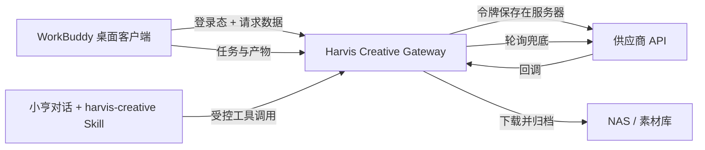

# Harvis AI 创作模块设计

## 目标

为已登录且已审批的 WorkBuddy 用户提供两个原生创作入口：

- Harvis 音乐创作：Suno V5.5 纯音乐的自由模式和业务提示词助手模式。
- Harvis 图片创作：GPT Image2 的文生图、图生图和品牌模板。

供应商令牌属于公司机密，不进入 Tauri 安装包、前端状态、日志或系统 Skill 文本。桌面端只调用公司控制的 Harvis Creative Gateway。

## 已验证供应商契约

测试日期：2026-08-10。

| 能力 | 创建接口 | 状态接口 | 已验证结果 |
| --- | --- | --- | --- |
| Suno V5.5 纯音乐 | `POST /_open/suno/music/generate` | `GET /_open/suno/music/getState?taskBatchId=...` | 创建成功；两个音频均进入 `status=30` 并返回音频、封面和 clip ID |
| GPT Image2 | `POST /_open/ai/task/api/gptImage/gene2img` | `GET /_open/ai/task/api/getState?ids=...` | 创建成功；状态为 `finished` 并返回图像 URL |

请求使用国内服务地址 `https://dzwlai.com/apiuser`。服务端请求头使用 `x-token` 和稳定的内部用户标识；兼容供应商文档中 `x-userId1` / `x-userId` 的表述差异，网关同时发送两者且值相同。

## 范围

### V1 包含

1. 工作台一级导航“AI 创作”，下含“Harvis 音乐创作”和“Harvis 图片创作”。
2. 音乐自由模式：纯音乐、时长、曲风、情绪、标题、可编辑提示词。
3. 音乐助手模式：系列、品牌、腕表风格、使用场景等业务选项，生成可编辑的品牌 BGM 提示词。
4. 图片文生图、图生图、品牌快捷模板和比例预设。
5. 异步任务列表、状态刷新、产物预览、下载、保存到素材库、放入会话输入框。
6. 一个 `harvis-creative` 系统 Skill 和结构化工具，使对话中的图片或音乐制作需求可直接发起任务。
7. 网关侧任务持久化、轮询兜底、供应商回调接收和成品永久归档到公司素材库。

### V1 不包含

- 音乐续写、翻唱、Persona、音色克隆或人声克隆。
- 管理员控制台中的供应商切换、计费结算和配额配置页面。
- 将生成结果自动发送到聊天或 IM。结果只能进入素材库或会话输入框草稿。

## 架构

Creative Gateway 部署在现有营销工作台服务中，使用既有登录用户身份和数据库。供应商令牌由服务进程环境变量读取：

- `HARVIS_VENDOR_BASE_URL`
- `HARVIS_VENDOR_TOKEN`
- `HARVIS_CALLBACK_BASE_URL`

服务端不向客户端返回供应商令牌、内部请求头或原始供应商任务参数。

## 数据模型

### creative_jobs

- `id`：内部 UUID。
- `user_id`：现有工作台用户 ID。
- `kind`：`music` 或 `image`。
- `mode`：音乐为 `free` / `assistant`，图片为 `text` / `image`。
- `vendor`、`vendor_task_id`、`vendor_batch_id`。
- `status`：`queued`、`processing`、`succeeded`、`failed`、`expired`。
- `progress`、`progress_message`、`prompt_snapshot`、`options_json`、`error_message`。
- `callback_nonce`：随机且一次性校验的回调标识。
- `created_at`、`updated_at`、`completed_at`。

### creative_artifacts

- `id`、`job_id`、`kind`（音频、封面、图片、视频预览）。
- `asset_id`：归档后的营销素材库记录。
- `storage_key`、`mime_type`、`byte_size`、`width`、`height`、`duration_seconds`。
- `source_url_expires_at`：只作后台追踪，客户端不显示供应商临时 URL。

### creative_templates

管理员维护系列、品牌、腕表风格、场景和模板；系列决定其可选字段和提示词骨架。Word 和 Excel 中的曲风与纯音乐约束整理为可查询的受控词库，不将整份文档塞入每轮模型上下文。

## 音乐创作

### 自由模式

默认走 `inputType="20"`、`mvVersion="chirp-v5-5"`、`makeInstrumental=true`。用户填写或编辑 `tags`，可选择 10 至 360 秒时长。网关发送空歌词、负向人声约束和标题。

### 助手模式

界面先用确定性模板即时组成可预览提示词，保证表单一变更就有结果，不耗 LLM token。用户点击“让小亨润色”时，当前会话模型只接收已选字段和曲风词库中相关项，返回可编辑的 `tags` 和结构建议。

所有纯音乐都追加：`instrumental only, completely no vocals, no voice samples, no speech, no humming, no chanting, clean balanced mixing`。

提交后网关创建任务。供应商正常返回两首版本；每个版本独立归档为音频与封面素材。

## 图片创作

### 输入和模板

支持文本提示词、参考图、品牌模板、负面提示词预留字段。参考图先上传到公司对象存储，网关仅向供应商发短时可读取的 URL，且校验 MIME、大小和用户归属。

模板包括新品主视觉海报、活动邀请函、腕表细节海报、节日社媒图。模板只写入提示词和默认比例，用户仍可编辑后生成。

### 比例与像素输出

| 用户预设 | 创作接口比例 | 最终归档 |
| --- | --- | --- |
| 电视屏幕（16:9） | `16:9` | 原始输出 |
| 竖屏（9:16） | `9:16` | 原始输出 |
| 门店海报（420x592） | `3:4` | 输出阶段裁切并缩放到 420x592 |
| 手机全屏（2868x1320） | `16:9` | 输出阶段裁切并缩放到 2868x1320 |
| 自定义 | 选择最接近的供应商支持比例 | 输出阶段按用户像素尺寸裁切并缩放 |

GPT Image2 文档只列出固定 `aspect_ratio`，不能承诺原生像素尺寸。界面在提交前展示“模型构图比例”和“归档像素尺寸”；后处理采用中心裁切，避免把内容拉伸变形。

## 网关行为

1. 以现有登录 Cookie 或令牌确认已审批用户，未登录或未审批返回统一权限错误。
2. 校验提示词长度、参考图类型与大小、音乐时长、并发任务数和用户所有权。
3. 创建 `creative_jobs` 后调用供应商接口，保存供应商任务 ID。
4. 提供公网上可访问的随机回调 URL；回调只用随机 nonce 定位任务，不信任回调体中的用户身份。
5. 每 15 至 20 秒轮询未完成任务，回调与轮询使用幂等状态合并。
6. 任务成功时立即下载音频、封面或图片到 NAS，并创建素材库记录。供应商临时链接到期不影响交付。
7. 失败时保存经脱敏后的供应商错误，允许用户创建一份可编辑的重试草稿，不自动重复扣费。

## 客户端行为

客户端只访问 Gateway：

- `POST /api/creative/music/jobs`
- `POST /api/creative/image/jobs`
- `GET /api/creative/jobs/:id`
- `GET /api/creative/jobs?mine=true`
- `POST /api/creative/jobs/:id/retry`
- `POST /api/creative/jobs/:id/stage-for-chat`

任务卡片显示本地状态、进度、失败信息和产物。保存到素材库自动完成；“放入会话输入框”仅创建附件草稿并跳转聊天，不发送消息。

## 系统 Skill

新增系统 Skill `harvis-creative`，并注册以下受控工具：

- `harvis_create_music`
- `harvis_create_image`
- `harvis_get_job`
- `harvis_stage_artifact_for_chat`

Skill 规则：用户仅要求写提示词时不得创建收费任务；实际创作前须有明确的制作意图和可用提示词。模型不得输出供应商令牌或 API 地址；生成完成后返回内部任务卡片和归档产物，而非供应商裸链接。

## 安全与合规

- 供应商令牌只在 11.29 服务端环境变量或受管密钥存储中出现。
- 所有接口依赖现有登录身份，并按 `user_id` 过滤任务和素材。
- 对参考图执行文件大小、MIME 与可读性校验；拒绝本机绝对路径和任意内网 URL。
- V1 禁止声音克隆、受保护艺人风格复刻和未经授权的肖像或品牌素材输入。
- 日志仅保留内部任务 ID、用户 ID、状态与脱敏错误，禁止记录请求头令牌。

## 验收与测试

1. 单元测试：供应商请求构建、比例映射、状态映射、权限和所有权检查、回调幂等、提示词模板。
2. 集成测试：模拟供应商创建、轮询、回调、失败和归档流程。
3. 客户端测试：自由/助手模式、比例选择和自定义像素、任务轮询、素材库归档、会话附件草稿。
4. 手工验收：用公司测试账号各生成一条 45 秒纯音乐和一张带参考图的门店海报，确认登录权限、进度、预览、NAS 归档和会话草稿完整闭环。

## 分阶段交付

1. Gateway 数据表、供应商适配器、任务 API、轮询和 NAS 归档。
2. WorkBuddy 两个原生页面及任务卡片。
3. `harvis-creative` 系统 Skill、工具注册和聊天附件草稿。
4. 管理员模板与配额配置、监控与正式发布。
